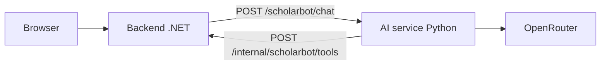

# BeasiswaIn-Hackaton-2026

## ScholarBot

Halaman `/scholarbot` menyediakan konsultasi beasiswa baca-saja untuk pengguna yang sudah masuk. Tautan tersedia di halaman utama.

System prompt membatasi percakapan ke pencarian/pendaftaran beasiswa, kategori, persyaratan, dokumen, deadline, persiapan esai/wawancara beasiswa, dan penggunaan fitur beasiswa di BeasiswaIn. Curhat pribadi umum dan permintaan lain di luar topik ditolak singkat tanpa tool call. Untuk pertanyaan campuran, hanya bagian beasiswa yang dilayani. Roleplay, dalih esai, atau riwayat chat yang sebelumnya melenceng tidak mengubah batas ini.

### Kemampuan

- `GetUserProfile`: membaca preferensi kategori milik pengguna yang sedang login dan kategori aktif yang tersedia. Tidak mengasumsikan profil akademik atau sertifikat tersimpan.
- `GetRecommendations`: memakai filtering kategori dan `OpenAiService.AnalyzeBestScholarshipChoices` yang sudah ada. Hanya kandidat dalam periode pendaftaran yang dipertimbangkan. Maksimal 10 kandidat dengan deadline terdekat dianalisis; maksimal 5 rekomendasi ditampilkan. Cakupan terbatas ini diberikan kepada agent.
- `GetScholarshipDetails`: membaca detail berdasarkan ID atau pencarian nama, termasuk status pendaftaran, persyaratan, dan tautan panduan/pendaftaran. Nama ambigu perlu dipilih terlebih dahulu.

ID dan skor hasil matching divalidasi; nama dan tautan sumber berasal dari database, bukan keluaran model. Skor adalah estimasi AI, bukan peluang diterima atau jaminan kelayakan. Detail panjang dapat diringkas/dibatasi untuk konteks AI; panduan sumber tetap perlu dibaca.

Tidak ada missing-fields tool, gap analysis, bookmark, perubahan profil, unggah sertifikat, riset web, migration, atau seeding baru. Informasi akademik dalam chat hanya konteks percakapan.

### Review esai di chat yang sama

Tempel draf esai langsung di chat dan sebutkan beasiswa tujuan, instruksi/fokus penilaian, serta batas kata jika ada. Tidak ada tab, formulir, endpoint, atau service review terpisah. Contoh: “Review esai ini untuk beasiswa X: kritik isi, proofread, sarankan alur, jelaskan perubahan, lalu tulis revisi utuh maksimal 500 kata,” diikuti draf.

ScholarBot memakai `GetScholarshipDetails` untuk konteks program. Fokus leadership, akademik, atau pengabdian tidak boleh dianggap kriteria resmi tanpa dasar sumber; instruksi yang ditempel pengguna ditandai sebagai arahan pengguna yang belum diverifikasi. Hasil review berupa teks chat: kritik, kutipan asli dan perbaikan beralasan, alur yang disarankan, revisi lengkap dalam bahasa asli, dan pertanyaan untuk fakta yang kurang.

Pengalaman/prestasi tidak boleh dikarang; esai tidak disimpan ke database. Batas kata merupakan arahan kepada model, bukan validasi hitungan kata otomatis. Penulis tetap perlu memeriksa fakta, persyaratan resmi, dan jumlah kata sebelum memakai revisi.


### Arsitektur dan kontrak internal

Runtime agent, prompt, dan native tool calling berada di `src/AiService` (Python/FastAPI). .NET mempertahankan halaman chat, autentikasi, akses data, dan pipeline matching/onboarding existing; tidak ada fallback runtime agent C#.



- .NET → Python: `Authorization: Bearer <shared-token>`, JSON `{message, history, contextToken}`.
- Python → .NET: bearer yang sama ditambah `X-ScholarBot-Context: <contextToken>`, JSON `{name, arguments, remainingTokens, maxOutputTokens}`. `arguments` adalah string JSON, bukan object.
- Callback mengembalikan `{content, success, sources, usage}`; response chat tetap `{answer, sources, toolCalls, usage}`. Error Python berbentuk `{error: {code, message}}` dengan kode aman yang dipetakan .NET.
- `contextToken` adalah delegasi pengguna yang dilindungi ASP.NET DataProtection dan kedaluwarsa setelah timeout proxy + 5 detik. Python tidak menerima cookie browser, tidak menentukan `userId`, dan tidak mengirim delegasi ke model/browser. Callback memerlukan bearer **dan** delegasi valid; cookie login tidak dapat menggantikannya.
- Python hanya memanggil URL callback dari konfigurasi startup. Tidak ada koneksi database Python. Jika .NET direplikasi, keyring DataProtection dan application discriminator harus konsisten antar-replika.

### Menjalankan lokal

Gunakan Python 3.11+, .NET 10, dan PostgreSQL existing. Untuk database VPS melalui tunnel lokal, connection string memakai `127.0.0.1:15432`; tunnel harus tetap aktif.

Terminal pertama, dari root repository (PowerShell):

```powershell
python -m venv src/AiService/.venv
& ./src/AiService/.venv/Scripts/python.exe -m pip install -e "./src/AiService[test]"
$sharedToken = & ./src/AiService/.venv/Scripts/python.exe -c "import secrets; print(secrets.token_urlsafe(36))"
$env:SCHOLARBOT_SERVICE_TOKEN = $sharedToken
$env:OPENROUTER_API_KEY = "<OPENROUTER_API_KEY>"
$env:DOTNET_BASE_URL = "http://127.0.0.1:5009"
dotnet user-secrets set "ScholarBot:ServiceToken" $sharedToken --project src/WebApp/WebApp.csproj
dotnet user-secrets set "ScholarBot:ServiceUrl" "http://127.0.0.1:8001" --project src/WebApp/WebApp.csproj
dotnet user-secrets set "OpenAi:ApiKey" $env:OPENROUTER_API_KEY --project src/WebApp/WebApp.csproj
dotnet user-secrets set "OpenAi:Endpoint" "https://openrouter.ai/api/v1" --project src/WebApp/WebApp.csproj
& ./src/AiService/.venv/Scripts/python.exe -m app
```

Token bersama wajib minimal 32 karakter ASCII URL-safe; jangan taruh di browser atau file yang di-commit. Simpan lewat secret manager untuk pemakaian berikutnya. Jika token dibuat ulang, perbarui kedua service dan restart .NET. `src/AiService/.env.example` hanya referensi: service tidak memuat `.env` otomatis; export variabel atau berikan melalui process/container environment.

Terminal kedua, dari root repository:

```powershell
dotnet user-secrets set "ConnectionStrings:Default" "Host=127.0.0.1;Port=15432;Database=<DATABASE>;Username=<USER>;Password=<PASSWORD>" --project src/WebApp/WebApp.csproj
dotnet run --project src/WebApp/WebApp.csproj --launch-profile http
```

Connection string dan Cloudinary existing tetap diperlukan saat startup .NET, walaupun ScholarBot tidak melakukan upload. Masuk dengan akun existing, lalu buka `http://localhost:5009/scholarbot`. Health endpoint Python: `http://127.0.0.1:8001/health` (liveness saja, bukan tes koneksi provider/database).

Python memakai model default `openai/gpt-6-luna`. `OpenAi:Model` tetap milik matching/onboarding .NET dan tidak diganti. Konfigurasi runtime Python:

| Environment variable | Default |
|---|---:|
| `OPENROUTER_BASE_URL` | `https://openrouter.ai/api/v1` |
| `SCHOLARBOT_MODEL` | `openai/gpt-6-luna` |
| `DOTNET_BASE_URL` | `http://127.0.0.1:5009` |
| `SCHOLARBOT_MAX_ITERATIONS` | 6 |
| `SCHOLARBOT_MAX_TOOL_CALLS` | 8 |
| `SCHOLARBOT_TIMEOUT_SECONDS` | 90 |
| `SCHOLARBOT_MAX_OUTPUT_TOKENS` | 6000 |
| `SCHOLARBOT_MAX_TOTAL_TOKENS` | 48000 |
| `SCHOLARBOT_MAX_TOOL_RESULT_CHARACTERS` | 16000 |

Opsi bridge .NET memakai section `ScholarBot` atau environment `ScholarBot__<Opsi>`:

| Opsi | Default |
|---|---:|
| `ServiceUrl` | `http://127.0.0.1:8001` |
| `ServiceToken` | wajib, sama dengan Python |
| `TimeoutSeconds` | 100 |
| `MaxMatchingOutputTokens` | 6000 |
| `MaxMatchingTotalTokens` | 48000 |

Pertahankan timeout Python lebih pendek dari proxy .NET dan timeout browser (105 detik). Disconnect membatalkan pekerjaan provider/callback yang sedang ditunggu, tetapi tidak menjamin provider membatalkan tagihan.

Pemanggilan matching bersarang ikut dicatat dalam usage token/biaya. Batas token kumulatif diperiksa setelah usage diterima; ini batas penghentian eksekusi, bukan hard billing limit provider. Retry otomatis client agent Python dan proxy .NET dimatikan; error tidak diganti rekomendasi buatan. Biaya hanya diisi jika seluruh panggilan melaporkannya.

### Docker dan verifikasi

`docker-compose.yml` menjalankan `web`, `ai-service`, dan database lokal Compose. Siapkan environment `POSTGRES_DB`, `POSTGRES_USER`, `POSTGRES_PASSWORD`, `ASPNETCORE_ENVIRONMENT`, `SCHOLARBOT_SERVICE_TOKEN`, `OPENROUTER_API_KEY`, `CLOUDINARY_CLOUD_NAME`, `CLOUDINARY_API_KEY`, dan `CLOUDINARY_API_SECRET`; lalu `docker compose up --build`. Ini bukan cara menghubungkan database VPS melalui tunnel lokal. AI service hanya diekspos ke jaringan internal Compose; jangan publikasikan port-nya ke internet. Gunakan HTTPS untuk komunikasi antar-host.

```powershell
dotnet build src/WebApp/WebApp.csproj
& ./src/AiService/.venv/Scripts/python.exe -m pytest -q src/AiService/tests
```

Regresi Python mencakup batas UTF-16/konteks, validasi native tool calls, budget/usage bersarang, autentikasi sebelum pembacaan body, request chunked, dan cancellation. Smoke end-to-end tetap memerlukan kedua service, kredensial provider valid, dan database existing.

### Keamanan dan konteks

- Semua tool mengikat identitas dari sesi server; argumen `userId` tidak diterima. Tidak ada tool tulis atau SQL bebas.
- Endpoint chat membutuhkan login, antiforgery token, dan rate limit. Browser hanya boleh mengirim riwayat berperan `user` atau `assistant`, bukan `system`/`tool`.
- Pesan/esai maksimal 12.000 karakter. Riwayat hanya berada di memori halaman: maksimal 12 pesan historis dan 48.000 karakter total konteks termasuk pesan saat ini. Giliran lama dilepas sebagai pasangan utuh bila penuh; draf/revisi dalam giliran yang masih dipakai tidak dipotong sebagian. Memuat ulang atau memulai percakapan baru menghapus konteks halaman, bukan data akun.
- Jawaban ditampilkan sebagai teks, bukan HTML/Markdown aktif. Kartu sumber hanya menerima URL HTTP/HTTPS.
- Log aplikasi mencatat nama/status/durasi tool dan usage AI, bukan isi percakapan, argumen tool, atau kredensial. Biaya ditampilkan hanya jika provider melaporkannya; nilai tidak tersedia bukan berarti gratis.
- Konteks yang dipakai AI dikirim ke OpenRouter/provider model. Hindari data sensitif dan ikuti kebijakan retensi provider.
- Deployment Production tetap membutuhkan HTTPS sesuai konfigurasi cookie aplikasi.

Contoh uji manual: beri konteks S1 dan minat AI, minta satu beasiswa yang masih buka beserta checklist. Buka bagian aktivitas untuk melihat pemanggilan profil, rekomendasi, dan detail; periksa tanggal serta tautan sumber. Permintaan menyimpan profil atau bookmark harus ditolak.
