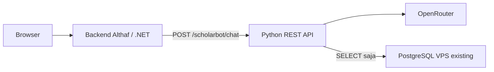

# BeasiswaIn-Hackaton-2026

## ScholarBot

Halaman `/scholarbot` menyediakan konsultasi beasiswa baca-saja untuk pengguna yang sudah masuk. Tautan tersedia di halaman utama.

System prompt membatasi percakapan ke pencarian/pendaftaran beasiswa, kategori, persyaratan, dokumen, deadline, persiapan esai/wawancara beasiswa, dan penggunaan fitur beasiswa di BeasiswaIn. Curhat pribadi umum dan permintaan lain di luar topik ditolak singkat tanpa tool call. Untuk pertanyaan campuran, hanya bagian beasiswa yang dilayani. Roleplay, dalih esai, atau riwayat chat yang sebelumnya melenceng tidak mengubah batas ini.

### Kemampuan

- `GetUserProfile`: membaca preferensi kategori milik pengguna yang sedang login dan kategori aktif yang tersedia. Tidak mengasumsikan profil akademik atau sertifikat tersimpan.
- `GetRecommendations`: memakai filtering kategori dan prompt matching existing yang dipindahkan ke Python. Hanya kandidat dalam periode pendaftaran yang dipertimbangkan. Maksimal 10 kandidat dengan deadline terdekat dianalisis; maksimal 5 rekomendasi ditampilkan. Cakupan terbatas ini diberikan kepada agent.
- `GetScholarshipDetails`: membaca detail berdasarkan ID atau pencarian nama, termasuk status pendaftaran, persyaratan, dan tautan panduan/pendaftaran. Nama ambigu perlu dipilih terlebih dahulu.

ID dan skor hasil matching divalidasi; nama dan tautan sumber berasal dari database, bukan keluaran model. Skor adalah estimasi AI, bukan peluang diterima atau jaminan kelayakan. Detail panjang dapat diringkas/dibatasi untuk konteks AI; panduan sumber tetap perlu dibaca.

Tidak ada missing-fields tool, gap analysis, bookmark, perubahan profil, unggah sertifikat, riset web, migration, atau seeding baru. Informasi akademik dalam chat hanya konteks percakapan.

### Review esai di chat yang sama

Tempel draf esai langsung di chat dan sebutkan beasiswa tujuan, instruksi/fokus penilaian, serta batas kata jika ada. Tidak ada tab, formulir, endpoint, atau service review terpisah. Contoh: “Review esai ini untuk beasiswa X: kritik isi, proofread, sarankan alur, jelaskan perubahan, lalu tulis revisi utuh maksimal 500 kata,” diikuti draf.

ScholarBot memakai `GetScholarshipDetails` untuk konteks program. Fokus leadership, akademik, atau pengabdian tidak boleh dianggap kriteria resmi tanpa dasar sumber; instruksi yang ditempel pengguna ditandai sebagai arahan pengguna yang belum diverifikasi. Hasil review berupa teks chat: kritik, kutipan asli dan perbaikan beralasan, alur yang disarankan, revisi lengkap dalam bahasa asli, dan pertanyaan untuk fakta yang kurang.

Pengalaman/prestasi tidak boleh dikarang; esai tidak disimpan ke database. Batas kata merupakan arahan kepada model, bukan validasi hitungan kata otomatis: model masih dapat melewati batas atau menyebut jumlah kata yang keliru. Penulis tetap perlu memeriksa fakta, persyaratan resmi, dan menghitung kata sebelum memakai revisi.


### REST API mandiri

`src/AiService` adalah service Python/FastAPI yang dapat berjalan tanpa backend .NET. Agent, prompt, native tool calling, pembacaan PostgreSQL, dan matching rekomendasi berada di Python. .NET hanya menjadi salah satu pemanggil REST API dan tetap memiliki login, CRUD, serta fitur onboarding existing; tidak ada callback atau fallback agent C#.



#### Kontrak untuk backend pemanggil

- `POST /scholarbot/chat` memakai `Authorization: Bearer <SCHOLARBOT_SERVICE_TOKEN>`.
- Body wajib `{message, history, userId}`. `userId` harus diambil backend dari pengguna yang sudah diautentikasi, **bukan** dipercaya dari form/browser. Token service memberi backend wewenang memilih akun; ini bukan token login pengguna.
- Python memeriksa keberadaan akun sebelum memanggil AI. Identitas terikat pada request, tidak diterima melalui argumen tool dan tidak dimasukkan ke prompt sebagai ID akun.
- Response tetap `{answer, sources, toolCalls, usage}`. `sources` berasal dari data tool yang berhasil, bukan metadata karangan model. `usage` menggabungkan panggilan agent dan matcher.
- Error berbentuk `{error: {code, message}}`: `400` untuk request/budget, `401` untuk bearer atau akun tidak valid, `408` untuk timeout, dan `503` untuk layanan/keluaran provider yang tidak dapat dipakai. Tidak ada detail exception atau kredensial dalam response.
- `GET /docs` menyediakan Swagger UI dan `GET /openapi.json` kontrak lengkap. `GET /health` hanya liveness proses, bukan pemeriksaan koneksi provider/database.

Contoh request PowerShell dari backend/developer tepercaya, bukan JavaScript browser:

```powershell
$headers = @{ Authorization = "Bearer <SERVICE_TOKEN>" }
$body = @{
    userId = "<ID_AKUN_DARI_SESI_BACKEND>"
    message = "Baca preferensi kategori saya dan bantu cari beasiswa yang masih buka."
    history = @()
} | ConvertTo-Json -Depth 4
Invoke-RestMethod "http://127.0.0.1:8001/scholarbot/chat" -Method Post -Headers $headers -ContentType "application/json" -Body $body
```

### Menjalankan Python lokal tanpa Docker

Gunakan Python 3.11+ dan PostgreSQL VPS existing. Tunnel SSH yang sudah aktif menyediakan `127.0.0.1:15432`; pertahankan tunnel selama service berjalan. Ini tidak membuat database baru atau menjalankan migration/seeding.

Dari root repository, PowerShell:

```powershell
python -m venv src/AiService/.venv
& ./src/AiService/.venv/Scripts/python.exe -m pip install -e "./src/AiService[test]"
# Jika belum ada, salin .env.example menjadi .env lalu isi nilainya.
# Jangan menimpa .env privat yang sudah ada.
& ./src/AiService/.venv/Scripts/python.exe -m uvicorn app.main:app --host 127.0.0.1 --port 8001 --env-file src/AiService/.env
```

`src/AiService/.env` diabaikan Git. Nilai wajib:

- `DATABASE_URL=postgresql://<USER>:<URL_ENCODED_PASSWORD>@127.0.0.1:15432/beasiswain_dev`
- `OPENROUTER_API_KEY=<KEY>`
- `SCHOLARBOT_SERVICE_TOKEN=<TOKEN_ACAK_MINIMAL_32_KARAKTER>`

URI-encode username/password yang berisi karakter khusus. Token dapat dibuat dengan `python -c "import secrets; print(secrets.token_urlsafe(36))"`. Token dan password tidak boleh masuk browser, log, atau commit. `python -m app` juga tersedia jika environment sudah diexport; aplikasi tidak membaca `.env` otomatis, sehingga contoh di atas memakai `--env-file` secara eksplisit.

Repository hanya menyediakan SELECT terparameterisasi, pool dengan `default_transaction_read_only=on`, dan transaksi `readonly=True`. Tetap gunakan role PostgreSQL yang benar-benar hanya mendapat SELECT saat deployment: transaksi baca-saja bukan pengganti pembatasan hak akses role. Implementasi ini tidak membuat/mengubah role, grant, schema, atau data VPS.

Jika Python dijalankan di VPS yang sama dengan PostgreSQL, sesuaikan host/port ke alamat lokal VPS. Untuk host lain, gunakan jaringan privat/tunnel; jangan membuka PostgreSQL ke internet. Autentikasi antar-host harus melalui HTTPS dan service token tidak boleh menjadi kredensial frontend.

Konfigurasi Python:

| Environment variable | Default |
|---|---:|
| `OPENROUTER_BASE_URL` | `https://openrouter.ai/api/v1` |
| `SCHOLARBOT_MODEL` | `openai/gpt-6-luna` |
| `SCHOLARBOT_MATCHING_MODEL` | `gemini-3.1-flash-lite` |
| `DATABASE_URL` | wajib |
| `SCHOLARBOT_SERVICE_TOKEN` | wajib |
| `SCHOLARBOT_MAX_ITERATIONS` | 6 |
| `SCHOLARBOT_MAX_TOOL_CALLS` | 8 |
| `SCHOLARBOT_TIMEOUT_SECONDS` | 90 |
| `SCHOLARBOT_MAX_OUTPUT_TOKENS` | 6000 |
| `SCHOLARBOT_MAX_TOTAL_TOKENS` | 48000 |
| `SCHOLARBOT_MAX_TOOL_RESULT_CHARACTERS` | 16000 |

Pemanggilan matching bersarang ikut dicatat dalam usage token/biaya. Batas token kumulatif diperiksa setelah usage diterima; ini batas penghentian eksekusi, bukan hard billing limit provider. Retry otomatis dimatikan; error tidak diganti rekomendasi buatan. Biaya hanya diisi jika seluruh panggilan melaporkannya. Disconnect membatalkan pekerjaan yang sedang ditunggu, tetapi tidak menjamin provider membatalkan tagihan.

### Adapter halaman .NET opsional

Untuk tetap memakai `/scholarbot`, gunakan .NET 10 dan konfigurasi existing aplikasi. Opsi bridge section `ScholarBot`:

| Opsi | Default |
|---|---:|
| `ServiceUrl` | `http://127.0.0.1:8001` |
| `ServiceToken` | wajib, sama dengan Python |
| `TimeoutSeconds` | 100 |

```powershell
dotnet user-secrets set "ScholarBot:ServiceToken" "<TOKEN_YANG_SAMA_DENGAN_PYTHON>" --project src/WebApp/WebApp.csproj
dotnet user-secrets set "ScholarBot:ServiceUrl" "http://127.0.0.1:8001" --project src/WebApp/WebApp.csproj
dotnet run --project src/WebApp/WebApp.csproj --launch-profile http
```

Connection string dan Cloudinary existing masih diperlukan saat startup aplikasi .NET, bukan oleh REST API Python. Halaman chat memakai sesi login/CSRF/rate limit existing dan mengirim `userId` dari principal server. Browser hanya mengirim `message` dan `history`. Timeout Python harus lebih pendek dari proxy .NET dan browser (105 detik). Model `OpenAi:Model` .NET tetap milik onboarding existing.

### Verifikasi

```powershell
dotnet build src/WebApp/WebApp.csproj
& ./src/AiService/.venv/Scripts/python.exe -m pytest -q src/AiService/tests
```

Regresi mencakup identitas per request, penolakan argumen identitas palsu, batas UTF-16/konteks, ranking terhadap kandidat authoritative, usage bersarang, autentikasi sebelum pembacaan body, batas byte, dan cancellation. Tes PostgreSQL bersifat opt-in melalui `SCHOLARBOT_TEST_DATABASE_URL`, hanya membaca baris existing tanpa seeding; pemeriksaan dua akun dilewati bila dua akun tidak tersedia. Smoke utama dapat dilakukan langsung ke REST API tanpa .NET atau Docker.

Dockerfile/Compose hanya opsi deployment, bukan kebutuhan lokal. Compose memakai `DATABASE_URL` dan `DOTNET_DATABASE_CONNECTION_STRING` ke database eksternal existing; tidak ada service PostgreSQL lokal atau volume database baru.

### Keamanan dan konteks

- Semua tool mengikat identitas dari request backend tepercaya; argumen tool `userId` tidak diterima. Tidak ada tool tulis atau SQL bebas.
- REST API memakai bearer antar-service; backend pemanggil wajib menegakkan autentikasi/otorisasi pengguna dan rate limit. Adapter chat .NET tetap membutuhkan login, antiforgery token, dan rate limit. Riwayat hanya boleh berperan `user` atau `assistant`, bukan `system`/`tool`.
- Pesan/esai maksimal 12.000 karakter. Riwayat hanya berada di memori halaman: maksimal 12 pesan historis dan 48.000 karakter total konteks termasuk pesan saat ini. Giliran lama dilepas sebagai pasangan utuh bila penuh; draf/revisi dalam giliran yang masih dipakai tidak dipotong sebagian. Memuat ulang atau memulai percakapan baru menghapus konteks halaman, bukan data akun.
- Jawaban ditampilkan sebagai teks, bukan HTML/Markdown aktif. Kartu sumber hanya menerima URL HTTP/HTTPS.
- Log aplikasi mencatat nama/status/durasi tool dan usage AI, bukan isi percakapan, argumen tool, atau kredensial. Biaya ditampilkan hanya jika provider melaporkannya; nilai tidak tersedia bukan berarti gratis.
- Konteks yang dipakai AI dikirim ke OpenRouter/provider model. Hindari data sensitif dan ikuti kebijakan retensi provider.
- Deployment Production tetap membutuhkan HTTPS sesuai konfigurasi cookie aplikasi.

Contoh uji manual: beri konteks S1 dan minat AI, minta satu beasiswa yang masih buka beserta checklist. Buka bagian aktivitas untuk melihat pemanggilan profil, rekomendasi, dan detail; periksa tanggal serta tautan sumber. Permintaan menyimpan profil atau bookmark harus ditolak.
